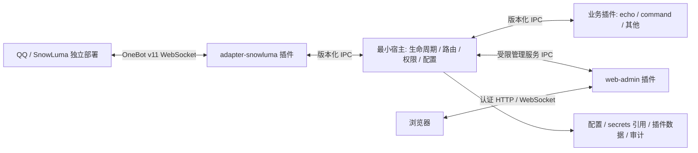

# TwinTail 项目设计与开发技能

> 状态：**P3 管理、配置与热重载已完成 Linux 本地验收**。已有 protocol/core/host/SDK、wire 1.2、本地包管理、配置事务与秘密引用、desired/applied、操作记录及 exclusive 替换/失败恢复；P2 BotRef、事件/动作/服务与 echo/mock 示例保留。P4 OneBot 类型库与 SnowLuma 正向 Universal WS 适配器已完成 Linux 本地验收及指定真实部署范围验证；Windows 运行仍待目标 runner，P5 WebUI 与独立管理插件已完成 Linux 本地验收；P6 已实现反向 Universal WS、候选发行、冷备份恢复和契约/有界负载工具；Linux 本地候选证据见发行文档，项目采用 MIT 许可证，设计见 [ADR 0007](docs/architecture/0007-p6-release-hardening.md)。当前接入实现见 [ADR 0005](docs/architecture/0005-p4-onebot-snowluma.md)与[适配器指南](docs/plugin-api/adapters.md)，真实证据见 [SnowLuma 兼容矩阵](docs/compatibility/snowluma.md)。
> 适用范围：TwinTail 的架构评审、功能实现、插件开发、测试与发布。执行约定见 [AGENT.md](AGENT.md)，所有项目改动同步记录到 [CHANGELOG.md](CHANGELOG.md)。

## 1. 目标与边界

TwinTail 是以 Rust 为核心的 QQ Bot 框架，使用 OneBot v11 作为首个通信协议，以“一切皆插件”为扩展原则，提供插件安装、启停、配置、热重载和 WebUI 可视化管理，并为插件作者提供版本化 SDK 与 API 文档。

“一切皆插件”的具体边界：宿主只包含启动与配置根、插件进程监管、IPC、能力授权、事件/动作/服务路由、存储命名空间与管理控制面。协议实现、QQ 平台接入、命令处理、业务逻辑、定时任务、WebUI 和 HTTP 管理服务器都属于插件。宿主不链接 SnowLuma 或 WebUI 的业务代码；它必须能在未启用这些插件时独立启动。

SnowLuma 是独立部署的 OneBot 实现，不内嵌到 TwinTail。`adapter-snowluma` 是 TwinTail 插件，负责连接 SnowLuma 暴露的 OneBot v11 服务。TwinTail WebUI 管理框架及插件；SnowLuma 自身的 QQ 登录、账号运维与其 WebUI 仍由 SnowLuma 负责。

MVP 支持单宿主、多插件、单个 SnowLuma 机器人；模型预留多适配器和多账号。跨宿主集群、远程插件市场、自动下载执行、完整 OneBot HTTP 传输、WASM 运行时与跨插件分布式事务不进入 MVP。

## 2. 技术选型与取舍

| 领域 | 设计基线 | 原因与限制 |
| --- | --- | --- |
| 宿主与官方插件 | Rust 2024、Cargo workspace、Tokio | 固定工具链与当前 MSRV 均为 1.99.1，写入 rust-toolchain.toml、rust-version 与 CI；后续依赖升级保持验证 |
| 插件隔离 | 独立进程 + 版本化 JSON IPC | 可真正替换可执行文件、隔离 panic/崩溃；有序列化开销，不等于操作系统沙箱 |
| 本地通信 | 宿主创建子进程，stdin/stdout 帧协议，stderr 日志 | 插件管道与本机管理分离；P1 管理使用 Unix socket，Windows 受限命名管道已实现，运行待验证 |
| 协议与 SDK | Serde、schemars；独立 wire 类型 crate | 跨进程不传 Rust 内存布局、trait 对象或裸指针 |
| 接入 | 独立 OneBot v11 协议 crate + SnowLuma 适配插件 | 协议类型可复用；SnowLuma 差异留在适配器 |
| 配置 | TOML 文件 + JSON Schema 校验 + 版本修订 | 人可编辑，WebUI 能表单化；WebUI 不直接读写配置文件 |
| Web 管理 | 官方 web-admin 插件，Axum + 静态前端 | 通过宿主管理服务操作插件；P5 使用 TypeScript/Vue 3/Vite，Node 26.7.0/npm 12.2.1 与锁文件固定 |
| 可观测性 | tracing、结构化日志、基础指标 | 插件日志需带实例、代次、请求和机器人上下文 |
| 测试 | Rust 单元/集成测试、协议夹具、故障注入 | 默认 CI 无需真实 QQ 账号；真机兼容性单独记录 |

不使用 Rust `dylib`/`cdylib` 作为默认插件接口：Rust ABI 不稳定，跨库分配器、panic 和卸载后回调难以约束。WASM 可作为后续执行后端，先保持同一逻辑协议，不提前承担 WASI 网络和权限模型的实现成本。进程隔离不能阻止插件直接访问宿主用户的文件与网络，MVP 仅运行受信任插件；宿主能力权限只约束经过宿主的调用。

## 3. 组件与数据流



事件路径：SnowLuma → 适配器解析并规范化 → 宿主校验来源与配额 → 按订阅投递业务插件。动作路径：业务插件 → SDK → 宿主校验权限与 BotRef → 适配器调用 OneBot API → 原路返回结果。WebUI 使用相同管理服务，不能跳过宿主状态机和配置校验。P5 通过带实例代次租约的 `management.call` 有界桥接接入，精确权限 `management.read` / `management.write` 分离，禁用任意插件业务调用。

依赖方向：wire 类型最底层；SDK 依赖 wire；宿主依赖 wire 而不依赖插件实现；插件依赖 SDK；OneBot 类型库不依赖宿主；前端遵循生成的 OpenAPI/Schema，CI 校验 HTTP 合同及静态发布资源漂移。插件之间通过命名且版本化的服务通信，不直接导入彼此实现。

建议逐阶段建立以下布局，未使用的目录无需提前创建：

```text
crates/
  twintail-protocol/       # IPC、能力、事件、动作和管理服务 wire 类型
  twintail-core/           # 状态机、配置、路由、授权、存储抽象
  twintail-host/           # CLI、启动、子进程监管与组合根
  twintail-plugin-sdk/     # Rust 插件开发 API、生命周期与服务封装
  twintail-onebot11/     # OneBot v11 类型、序列化和标准动作
adapters/
  adapter-snowluma/        # OneBot 连接、账号绑定与兼容差异
plugins/
  web-admin/              # P5 HTTP 管理接口、认证和静态资源托管
examples/
  echo-plugin/            # 最小可运行外部插件样例
web/                     # WebUI 前端
schemas/                 # manifest、配置与 IPC 导出 schema
config/                  # 无凭据的配置样例
docs/                    # 架构与插件开发文档
  architecture/          # ADR、威胁模型与设计细化
  plugin-api/            # 开发指南、协议和生命周期文档
  compatibility/         # SnowLuma 版本与 OneBot 能力验证记录
tests/fixtures/          # 脱敏 OneBot 与 IPC 数据
```

构建制品与运行数据分离：安装根目录只存只读版本包；数据根目录包含 `host.toml`、`plugins/<id>/config.toml`、`plugins/<id>/data/`、受保护的 secrets、暂存包和审计记录。禁止插件 id/包内路径中的目录穿越及越界符号链接。P0 路径和平台约定见 [ADR 0001](docs/architecture/0001-p0-baseline.md)，P0 当时仅解析路径；P1 正常运行读取 host.toml、验证包并创建私有运行目录，--check 保持不读写，--validate 离线验证。

## 4. 插件契约

### 4.1 清单、身份与依赖

插件包包含 `plugin.toml`、匹配目标平台的可执行文件、配置 JSON Schema、许可证和校验摘要。可执行文件路径限定在包目录内，禁止 shell 字符串启动。校验摘要用于损坏检测，不宣称等同于签名或可信来源。

清单设计字段：`id`（稳定且全局唯一）、`name`、`version`（SemVer）、`protocol_version`、`host_api`（兼容范围）、`entrypoint`、目标平台、`kind`（adapter/service/feature/admin，可多角色）、`capabilities`、事件订阅、服务声明、`config_schema`、`config_version`、强/可选依赖及版本范围、`reload_policy`。这是后续完整设计字段。P1 基线字段为 id/name/version/protocol_version/host_api/entrypoint/args/capabilities/required_capabilities/dependencies；P3 增加 config_schema/config_version/reload_policy/target。格式及实际语义见 [清单指南](docs/plugin-api/manifest.md)，其余规划字段尚无运行语义。

同一插件 id 默认只允许一个活动实例，但热重载期间可有两个代次。实例标识由宿主分配，为 `(plugin_id, instance_id, generation)`。机器人引用 `BotRef = (adapter_instance_id, self_id)`；内部 QQ 标识使用十进制字符串，OneBot 边界兼容合法数字形式，避免浏览器精度损失。禁止只依赖 QQ 号进行动作路由。

依赖拓扑排序后启动，逆序停止；强依赖缺失、版本不符或依赖环直接阻止激活并输出诊断。提供者失效时，依赖者转入 degraded 或暂停，禁止继续把服务请求送往已失效代次。禁用/卸载有依赖者的插件必须先处理依赖者；管理调用显式选择级联并预览影响，默认拒绝破坏依赖。

### 4.2 IPC v1 基线

stdin/stdout 使用 `4 字节大端长度 + UTF-8 JSON`；P1 帧硬上限 8 MiB（没有 CLI 调节项），长度校验先于分配，禁止在 stdout 输出日志。启动握手超时默认 10 秒；帧大小、并发、队列和超时均有宿主硬上限。stderr 是不可信输入；P1 仅以固定缓冲读取并丢弃，未实现日志展示、完整速率/CPU 限制或脱敏日志管线。

P1 信封含 `protocol_version: {major, minor}` 和 `kind`（request/response/event/control）；request 含 `request_id/method/payload`，control/event 含 `method/payload`；response 含 `request_id/outcome`，outcome 为 `{"status":"ok"|"err","value":...}`。当前没有 trace_id 字段的运行语义。线上的源身份由宿主依据管道绑定；插件自报身份不作为授权依据。generation 作为宿主内部路由元数据，旧进程无法伪装新代次。

握手按 hello → negotiate → initialize → ready 完成：协商协议/API 版本、读取授予能力、配置修订和数据目录，再报告 readiness。协议主版本不符拒绝加载；次版本仅允许增加可选字段。未知可选字段忽略，未知必需能力拒绝激活。P1 已从 wire 类型导出消息、hello、initialize schema，并用无 SDK 独立协议 fixture 验证；P2 已提供 SDK 与宿主互操作测试。P1 还需宿主发送 activate，实际信封及 outcome 格式见 [协议指南](docs/plugin-api/protocol.md)。

请求 ID 在连接内唯一，宿主添加实例/代次上下文，超时清理 pending 请求；连接断开、进程退出或代次退役使等待方收到明确错误。心跳、控制消息和动作响应使用独立优先队列，避免事件洪峰阻塞停止指令。

稳定错误类别至少覆盖：版本不兼容、权限不足、目标离线、超时、取消、队列满、配置无效、插件退出、重载失败和远端 OneBot 错误；保留原始 retcode 等诊断字段，日志不泄露 token 或完整敏感消息。

### 4.3 SDK 与能力

Rust SDK 提供生命周期处理器、事件订阅、动作客户端、命名服务、配置快照、结构化日志、健康上报、任务取消令牌及插件私有数据目录 API。异步处理使用有界并发；每个生命周期创建的任务都必须被插件任务组追踪，停止时取消并等待。

能力采用默认拒绝：如 `events.subscribe`、按动作限定的 `actions.call`、`services.provide/call`、`storage.private`、`management.read/write`。清单申请与宿主授予取交集；通配权限需显式配置，web-admin 也必须由宿主授权管理能力。私有存储不能通过 SDK 访问其他插件命名空间。SDK 不提供绕过授权的原始宿主通道。

适配器提供版本化连接服务（如 `onebot.v11`），注册 BotRef、上报连接健康、发布事件并执行动作；宿主只调度这些能力。通用 OneBot 传输/解析封装可在库中复用，SnowLuma 扩展使用独立命名空间和能力探测，不混入标准事件定义。

## 5. 事件与动作语义（P2 通用路由与 P4 OneBot 映射已实现）

事件封装包含 `event_id`（框架投递标识）、来源 BotRef、接收时间、协议类型、标准载荷和原始扩展字段。OneBot 消息保留原始消息段数组或 CQ 字符串，不隐式解析、拼接或转换 CQ 码。覆盖 message、notice、request、meta_event，未知类型保留原始 JSON，以原 post_type 精确订阅。

同一个 BotRef 的入站投递顺序由宿主保持；并发处理完成顺序不保证，插件可声明按会话串行。插件 fan-out 的一个订阅者处理慢不能无限阻塞其他订阅者。每插件有界队列与并发上限，队列满明确返回/记录 Overloaded、指标与缺口信息；MVP 不设持久事件队列，不承诺重启恢复或 exactly-once。

MVP 为内存中尽力投递：未确认事件在崩溃、超时或重载时可能丢失；不自动重放已开始处理的事件。event_id 只能帮助框架内关联，不能消除 OneBot 重连产生的所有重复。业务需要幂等时使用来源标识、消息 id 和业务键持久化去重；无来源唯一标识时如实暴露限制。

动作含 BotRef、调用 ID、参数和 deadline。适配器生成 OneBot `echo` 并维护 pending 表，按结构化协议识别响应与事件；不能仅凭有无 echo 判断帧类型。保留 status、retcode、data 与原始响应字段。断线/超时后可能已在远端执行，结果标为 unknown_outcome；发送消息、踢人等副作用动作不得自动重试。幂等查询可以使用有界重试，调用者必须能够区分离线、失败和结果未知。

P2 实际边界：`BotRef` 包含宿主分配的 adapter instance 和字符串账号；订阅为精确 event_type 集合，无 wildcard/会话串行声明。事件 payload 为不透明 JSON，不解析 OneBot；独立事件队列每实例32，发布返回 delivered/dropped 入队计数，不代表处理完成。实例退出撤销账号、订阅和服务；旧 BotRef 不映射到新代次。服务明确指定 provider、service、SemVer range，目标在调用时固定到当前代次。动作 `actions.call`/服务 `services.call` 为粗粒度权限，不按名称或参数细分。每连接插件请求 ID 累计预算仍为4096，达到上限需显式重启；无自动重连或重试。SDK 的事件/请求回调有界并发，应用自己 spawn 的任务须响应取消并自行 join。P3 已加入配置快照；结构化日志仍待后续阶段；P4 已加入无损 OneBot 类型和消息映射，适配器自行重连外部 WS。P2 不保证 SDK 应用回调完成顺序；宿主只保持事件入队顺序。

## 6. 热重载与失败恢复（P3 exclusive 已实现）

P3 实际契约：只支持 `exclusive`，`parallel_safe` 返回 Unsupported；拒绝替换有活动强依赖消费者的提供者。先暂停路由/排空（使用 request 期限，默认5秒），回收直接子进程，再启动候选。wire ≥1.2 还等待 SDK `start` 完成确认；legacy 仅保留旧握手。候选失败使用最近确认的旧配置与旧包重启，generation 继续增长；恢复失败保持 Failed，其他插件继续服务。返回 `outcome` 和 `drain_error`，不自动重放请求，也不暂存并迁移事件。取消 future 后内存重载 journal 由 supervisor 继续持有并可续作；宿主重启只把未完成持久操作标为 interrupted，不恢复内存阶段。详见 [重载指南](docs/plugin-api/hot-reload.md)。

以下为包含后续 parallel_safe、缓冲及进程树控制的完整演进目标；这些扩展尚未实现。

状态机：Discovered → Validated → Starting → Ready → Active → Draining → Stopped；启动失败进入 Failed，失联进入 Degraded。状态变更由宿主串行执行，并携带操作 ID。区分“进程存活”“IPC ready”“外部连接可用”。

热重载是替换插件进程，宿主持续运行；不承诺零丢事件、不中断连接或通用数据回滚。过程如下：

1. 加锁并记录操作，验证新包、协议/依赖/能力、配置 schema 与可用空间；版本目录不可原地覆盖。
2. 依据策略启动候选代次。`parallel_safe` 插件可先启动候选并完成 readiness，但激活前禁止外部副作用和共享数据写入，只能读取快照或写代次暂存目录；写权限在提交时转移，不能满足约束的插件使用 `exclusive`。`exclusive` 插件先暂停新投递、排空并停止旧代次、释放监听端口/外部租约，再启动候选。适配器和 web-admin 默认为 exclusive；排他策略按本步骤先执行下一步的排空操作。
3. 暂停该实例的新业务投递，在有界缓冲中暂存；旧代次在默认 30 秒 drain 窗口完成在途请求。超过窗口的调用明确失败或标注结果未知，不自动迁移/重发。
4. 候选 ready 后以单一提交点切换路由与注册表，旧代次禁止注册或发布新事件；恢复投递并完成旧代次清理。来源代次校验防止双重事件发布。超时 kill 必须由宿主确认进程树退出。
5. 提交前失败：parallel_safe 恢复原路由；exclusive 从旧包和旧配置重新启动。提交后启动故障：记录降级并尝试恢复旧包，无法恢复则保持 Failed、输出可操作诊断。已发生的外部副作用无法撤销。

重载期间控制队列仍须可用，缓冲溢出计数并产生事件缺口诊断。宿主接入连续 OneBot 事件的连接若因适配器重载断开，无法靠本地缓冲恢复远端遗漏事件。磁盘业务数据不自动随包回滚；破坏性迁移不得进入在线重载路径，需要停机、备份与独立迁移方案。插件状态默认通过私有持久存储恢复；可选 checkpoint 必须版本化、有大小限制且不得含未保护的密钥。

文件监视只在开发模式可选启用，需防抖、构建成功、临时文件排除和包完整性校验；生产默认显式调用 reload。修改能力、监听地址、密钥或协议版本通常要求重启实例。后续插件崩溃自动重启设计为指数退避、抖动与次数预算。P1 自动重启预算为 0，失败需显式 start 并增加 generation；只等待和清理直接子进程，禁止插件派生守护后代。

## 7. 配置、存储与管理（P3 本机服务与 P5 Web 管理已实现）

P3 实际契约：本地目录包按 `id/version` 原子安装，SHA256 检测损坏；摘要不是来源认证。配置存储为版本化 TOML，OS 文件锁保护 expected_revision CAS；秘密以环境引用保存，管理读仍是引用。更新按 prepare → 持久化 desired → commit → status 确认 applied，失败保留明确的不一致；落盘失败使用 config.abort 释放准备态。管理 CLI 提供包/配置/操作命令，操作仅记录安全摘要，终态 completed 的 reload 仍须查看 outcome 是否 rolled_back。直接本机管理 API 支持有限保留期内 request_key，CLI 暂未暴露该参数。完整方法与限制见 [配置指南](docs/plugin-api/configuration.md)、[存储指南](docs/plugin-api/storage.md)。P5 已提供独立 Web 服务与浏览器会话；诊断仅为有界安全操作记录，不提供原始 stderr 或日志订阅。

以下描述完整管理服务的设计目标。

宿主配置和插件配置分离；插件声明配置 schema、默认值、config_version 和是否支持在线应用。配置读取向插件提供不可变快照，敏感值通过受限注入解析。密钥存 secrets 引用或环境变量，不出现在样例、Git、浏览器返回值和普通日志中。

配置更新事务：携带 expected_revision → schema/语义校验 → 插件 prepare（无副作用）→ 同目录临时写入与持久化 → 原子替换 → 发布新修订并通知插件 commit。运行态应用失败时标记 desired_revision 与 applied_revision 不一致并保留错误，触发受控回滚/重启；崩溃恢复以磁盘期望配置为准。不宣称文件与进程间具有跨进程原子事务。并发旧修订返回 Conflict。非法编辑保留最后可用配置并给出字段路径错误。

插件包安装与启用分开；MVP 从本地校验包安装，拒绝目录穿越、越界链接、未知平台和不兼容包。卸载前停进程并解除注册，默认保留配置和业务数据，清除数据必须独立明确操作。操作审计记录主体、时间、目标、前后修订/版本、结果，避免记录明文配置秘密。

管理服务至少包括 list/get/status、install-local、enable/disable、reload、config get/validate/update、logs subscribe、health 和 operations get。耗时操作返回 operation_id，状态可查询，支持并发冲突检测；接口幂等键避免浏览器重复点击产生重复重载。Web 管理接口转发这些服务，不复制状态机。

web-admin 停用或自身配置失效后，宿主 CLI 必须能执行 `plugins list/enable/disable/reload`、离线配置校验和配置恢复。P1 定义本机管理通道并实施身份校验（Unix 域套接字权限；Windows 等价受限命名管道），与子进程 stdin/stdout 通道分离；P3 已提供包、配置与操作 CLI，P5 补 Web 管理集成，避免只能靠 WebUI 修复 WebUI。

## 8. WebUI 与安全（P5 实现）

WebUI MVP 页面：登录、运行概览、插件列表和详情、启停/重载操作进度、Schema 展示与带 CAS 的 JSON 配置编辑、脱敏日志、SnowLuma 连接状态和错误诊断。前端不得直接连接 SnowLuma 或持有 OneBot token。表单更新携带配置修订，页面显示 desired/applied 状态和需要重启提示。

管理端仅允许数字 loopback IP，默认 `127.0.0.1:17280`；首次凭据通过私有配置中的环境秘密引用注入，无通用默认密码。浏览器使用 HttpOnly、SameSite=Strict 会话 cookie；精确 Host/Origin、CSRF、固定会话 TTL、限流和有界连接/并发/请求体/执行期限均已实现。P5 不提供远程监听、TLS、管理 WebSocket 或原始日志订阅；后续远程部署须另行设计认证和可信代理边界。静态 CSP 禁止远端/内联脚本，Vue 文本转义插件内容，不把令牌放入 URL 或浏览器持久存储。

插件状态数据与管理权限独立；普通插件不能自提管理权限、安装程序或读取其他插件配置。web-admin 拥有管理能力属于信任边界，应记录管理调用。MVP 不支持从 WebUI 输入任意 shell 命令，也不在浏览器自动执行插件提供的 JavaScript 配置组件。

## 9. SnowLuma 与 OneBot v11 兼容性

P4 MVP 仅支持正向 Universal WebSocket：TwinTail 适配器作为客户端连接 SnowLuma 的 OneBot WS 服务，复用单连接接收事件和动作响应。地址、路径和 token 由配置提供，不硬编码外部产品默认端口。处理鉴权失败、heartbeat/lifecycle、连接断开、指数退避重连和优雅停止；WS ping/pong 与 OneBot heartbeat 分开处理。

后续实现反向 Universal WebSocket：SnowLuma 主动连接适配器监听地址，校验 Authorization、`X-Self-ID` 和 `X-Client-Role`，限制账号与连接角色。反向监听也属于适配器插件，不放入宿主。split API/Event 连接明确延期；HTTP API + HTTP 上报另列后续阶段，不以“完整支持 v11”掩盖传输范围。

2026-10-29 公开元数据核对到 SnowLuma v2.2.1 发布与 main HEAD，二者未被证明对应同一提交；具体来源见兼容矩阵。P4 已完成 Linux 本地验收及指定真实部署范围验证：Linux x64 WSL mirrored 客户端对 SnowLuma 2.2.1-node 完成查询/账号匹配、单次私聊与真实断线重连后的 Supervisor/独立插件业务闭环，用户确认收件。远端 OS/commit/SHA未知，notice/request、群聊、其他动作、Bearer/TLS及部署OS矩阵仍待测，不能据此宣称所有动作兼容。实施时固定测试版本/提交，保存脱敏事件样例与能力矩阵，记录标准接口、扩展、缺失字段和重连行为。SDK 不绑定未经验证的 SnowLuma 私有管理端点。

依据与后续核对入口：

- [OneBot v11 规范](https://github.com/botuniverse/onebot-11)
- [正向 WebSocket](https://github.com/botuniverse/onebot-11/blob/master/communication/ws.md)
- [反向 WebSocket](https://github.com/botuniverse/onebot-11/blob/master/communication/ws-reverse.md)
- [SnowLuma 仓库与 README](https://github.com/SnowLuma/SnowLuma)

## 10. 插件 API 文档交付标准

代码中的公有 Rust API 编写 rustdoc（参数、错误、取消、安全性与示例）；线协议与管理 HTTP API 分别由 wire 类型生成 JSON Schema 和 OpenAPI。生成物与源码一起评审，CI 校验不漂移。不得只提供一份架构概述就宣称 SDK 已有文档。

P1 已提供 [协议、清单、生命周期、权限、错误与排障指南](docs/plugin-api/README.md)，附非 SDK 测试 fixture 打包验证流程；P2 起扩充 `docs/plugin-api/`：quickstart、manifest、lifecycle、events、actions、configuration、permissions、storage、services、errors、hot-reload、migration 与 troubleshooting。quickstart 必须能从干净目录构建并加载示例，说明 SDK/宿主/IPC 版本关系、打包、调试日志与停用方法。协议错误示例不包含有效凭据。

维护 feature 插件和 adapter 插件两类指南；P4 补充适配器注册/连接健康/动作回包示例，P5 补管理 OpenAPI。发布 SDK 时包含可运行 echo 插件、契约测试工具与兼容迁移说明。破坏性 API 变更升级版本并同步 schema、示例、迁移文档及 CHANGELOG。

## 11. 开发阶段与验收

阶段以验收门槛推进，不用未经验证的工期替代完成条件。P0 → P1 → P2 → P3 → P4 → P5 → P6；P2 后可并行制作前端原型，但 P5 集成依赖 P3/P4 的真实管理与连接状态。

| 阶段 | 工作与交付物 | 验收门槛 |
| --- | --- | --- |
| P0 基线 | 将单包演进为 workspace；命名用 `twintail-*`；固定 MSRV/工具链、CI、目录与 ADR；建立架构/安全/兼容文档入口 | 空宿主能启动/退出；fmt、clippy、测试和文档检查通过；不带插件实现依赖 |
| P1 最小插件宿主 | wire v1 schema、进程监管、握手、能力、依赖拓扑、有界 IPC、基础 CLI 与本机管理通道 | 测试插件启动/停止；版本不兼容、超大帧、超时、权限越界、崩溃均得到确定错误；宿主保持可用 |
| P2 SDK 与路由 | Rust SDK、事件/动作/服务路由、BotRef、echo 示例、首版 rustdoc 与开发指南 | 无 QQ 账号可完成 mock 事件→插件→mock 动作闭环；隔离慢订阅者；示例文档从干净环境复现 |
| P3 管理、配置与热重载 | 本地包安装/卸载、schema 校验、修订冲突、秘密引用、生命周期操作记录、代次切换与回退 | A→B 重载可观测；B 启动失败恢复 A；在途超时、溢出、旧代次回包、端口占用、配置不一致与依赖失效有测试；其他插件仍服务 |
| P4 SnowLuma MVP | OneBot 类型库、adapter-snowluma 插件、正向 WS、鉴权/重连/echo、版本兼容记录、adapter 指南 | 夹具覆盖四类事件与未知字段；验证 retcode/超时/结果未知；指定真实 SnowLuma 版本完成收消息→业务→发消息，重连后可用；凭据不入库 |
| P5 WebUI（已完成 Linux 本地验收） | web-admin 插件、认证、插件与配置管理页、日志与连接诊断、OpenAPI、完整 CLI 救援路径 | 浏览器完成启停/重载/配置更新；并发更新冲突提示；CSRF/越权被拒绝；自身端口/配置重载失败可通过 CLI 恢复 |
| P6 发布加固 | 反向 WS、依赖升级/配置迁移、平台打包、负载与故障测试、安全说明、用户与插件文档定版 | Linux x64/arm64 与 Windows x64 明确验证矩阵；持续运行与队列资源上限可复现；版本/文档/CHANGELOG 对齐，先交付可校验 0.1 MVP 本地候选；公开 GitHub 发行已获授权，采用 MIT |

首次对外发布目标为 0.1 MVP；当前 Cargo 的 0.1.0 为工程及本地候选版本，不代表已公开发布或未测试平台已获认证。P6 后再评估 WASM、签名市场、持久化事件、HTTP 传输和多宿主部署。

项目实施入口：[README](README.md)、[架构索引](docs/architecture/README.md)、[安全边界](docs/architecture/security.md)、[兼容性记录](docs/compatibility/README.md)。实际 workspace 已有 `twintail-protocol`、`twintail-core`、`twintail-host`、`twintail-plugin-sdk`、`twintail-onebot11`、`adapters/adapter-snowluma` 及两个示例；源码路径为 `crates/twintail-*`。当前已有 list/status/start/stop/call、P3 包管理/配置事务/热重载及 P4 独立适配器；P5 已添加 `plugins/web-admin`、`web/` 和管理桥接，见 [ADR 0006](docs/architecture/0006-p5-web-admin.md)。缺失 host.toml 表示空计划。

## 12. 工作流程与设计变更

开始任务先读 AGENT.md、本文、CHANGELOG 和相关代码，定位当前阶段及验收条件；优先实现一条可运行纵向路径。涉及协议、权限、热重载、依赖方向或持久化兼容的变更先写 ADR 并标明取舍，再同步本文。新增插件功能同时补 SDK 示例/文档及失败路径验证。

每次项目变更在同一改动中更新 CHANGELOG 的 Unreleased；按 Added/Changed/Fixed/Removed/Security 分类，描述用户可感知变化并标出不兼容点。不可把计划功能记为已实现。发布时将已验收条目归档到版本和日期，未完成条目继续留在规划中。

实施后的基础检查：`cargo fmt --all -- --check`、`cargo clippy --workspace --all-targets -- -D warnings`、`cargo test --workspace`、`RUSTDOCFLAGS="-D warnings" cargo doc --workspace --no-deps`。前端存在后运行锁定依赖安装、类型检查、构建及关键交互测试。按变更风险增加协议契约、进程故障、配置恢复和重载测试；不为纯文档改动创建镜像实现的测试。

完成汇报注明实际改动、验证结果、尚未实现/验证的范围和后续阶段。不得以 mock 结果替代真实 SnowLuma 兼容性结论。
